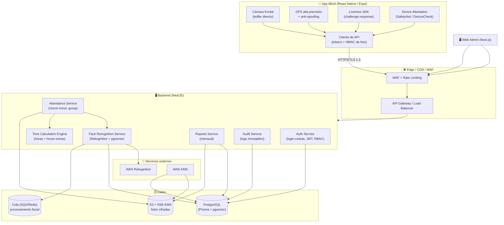
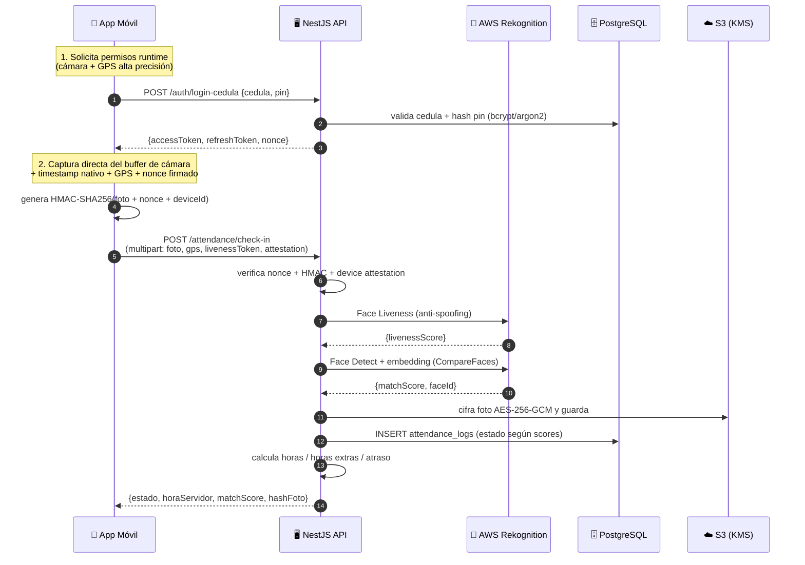
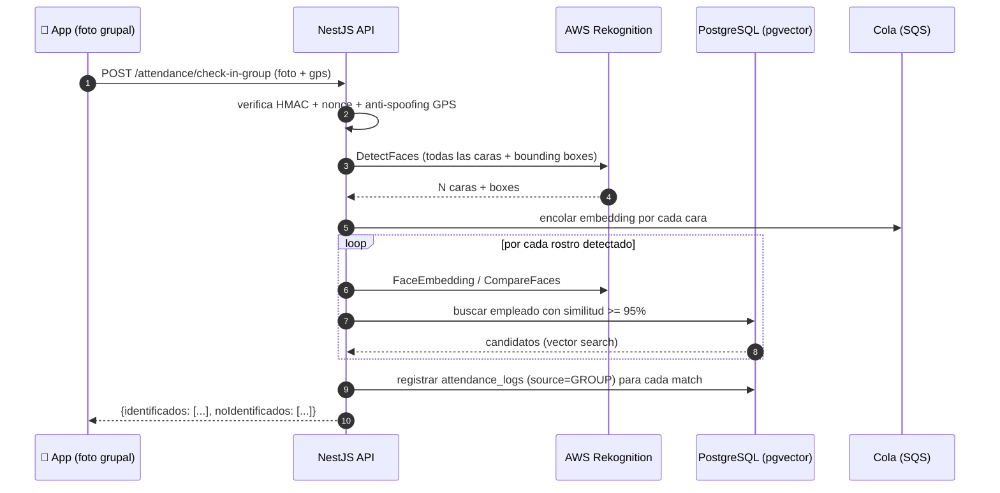

# 1. Arquitectura del Sistema — Control de Asistencia Inteligente

> Stack seleccionado (decisiones de liderazgo técnico):
> - **Móvil**: React Native (Expo) + TypeScript — un solo lenguaje en todo el stack, acceso nativo a cámara/GPS vía `expo-camera` y `expo-location`.
> - **Web Admin**: Next.js 14 (App Router) + TypeScript + Tailwind.
> - **Backend**: NestJS (Node.js + TypeScript).
> - **Base de datos**: PostgreSQL 16 + Prisma ORM + **pgvector** (incrustaciones faciales).
> - **Visión por computador / IA**: AWS Rekognition (Face Detect + CompareFaces + Face Liveness) con fallback local FaceNet.
> - **Almacenamiento**: S3 + SSE-KMS. **Seguridad**: JWT, TLS 1.3, AES-256-GCM (envelope encryption con KMS).

---

## 1.1 Diagrama de bloques de alto nivel

---

## 1.2 Flujo de datos seguro — captura individual (check-in)

### Pasos clave del flujo (numerados)

1. **Permisos en runtime** — la app pide cámara y ubicación "mientras se usa", nunca implícitos.
2. **Autenticación por cédula** — se valida `cédula + PIN/contraseña`; se emiten JWT de corta vida + refresh token rotativo.
3. **Captura anti-fraude** — la foto sale **directamente del buffer de la cámara** (no hay selector de galería); se captura `timestamp nativo` y se firma un `nonce` emitido por el servidor (anti-replay).
4. **Geolocalización** — se envía lat/long, precisión, proveedor (GPS/fused) y señales anti-mock.
5. **Liveness** — se valida que la imagen sea de una persona viva (no pantalla/impresión) con AWS Rekognition Face Liveness o challenge-response local.
6. **Reconocimiento** — se extrae el embedding facial y se compara contra el embedding de referencia cifrado (pgvector/Rekognition), umbral **≥ 95 %**.
7. **Persistencia cifrada** — la foto se cifra AES-256-GCM (clave KMS) y se guarda en S3; en BD solo se guarda la **referencia + hash**, nunca la imagen en claro.
8. **Cálculo** — el motor de tiempos consolida entrada/salida y genera horas ordinarias, extras y atraso.
9. **Respuesta** — se devuelve `horaServidor` (autoritativa), score y hash, dejando registro inmutable en `audit_logs`.

---

## 1.3 Flujo de asistencia grupal (múltiples rostros)

**Reglas del módulo grupal:**
- La foto grupal es **una sola imagen**; `DetectFaces` extrae todas las caras y sus `bounding boxes`.
- Cada cara genera un embedding que se compara contra toda la plantilla de empleados activos.
- Solo se registran automáticamente las coincidencias **≥ 95 %**; el resto se lista como "no identificado".
- Cada match genera un `attendance_log` individual enlazado a la misma `group_attendance_session`.
- Se notifica en pantalla la lista de personas identificadas (con avatar y nombre) y las no identificadas.

---

## 1.4 Componentes del backend (NestJS)

| Módulo | Responsabilidad | Endpoints clave |
|---|---|---|
| `AuthModule` | Login por cédula, refresh, RBAC | `POST /auth/login-cedula`, `POST /auth/refresh` |
| `AttendanceModule` | Check-in/out individual y grupal, validación facial/GPS | `POST /attendance/check-in`, `POST /attendance/check-in-group`, `POST /attendance/check-out` |
| `FaceRecognitionService` | Abstracción sobre Rekognition / FaceNet + pgvector | (interno) |
| `ReportsModule` | Reporte mensual consolidado | `GET /reports/monthly/:employeeId` |
| `AdminModule` | Corrección de asistencias, gestión usuarios, auditoría | `PATCH /admin/attendance/:id`, `GET /admin/audit-logs` |
| `AuditModule` | Registro inmutable de acciones | (interno, escribe `audit_logs`) |
| `TimeCalculationEngine` | Cálculo de horas ordinarias/extras/atraso | (interno, ver `time-calculator.ts`) |

---

## 1.5 Decisiones de escalabilidad

- **Cola (SQS/Redis BullMQ)** para el procesamiento facial pesado: el check-in responde rápido y el match se confirma asíncronamente.
- **pgvector + índice HNSW** para búsqueda de similitud coseno en `O(log n)` cuando hay miles de empleados.
- **Jobs nocturnos (cron)** para el motor de cálculo mensual y cierre consolidado.
- **Read replicas** para reportes y dashboard, escrituras solo en el primario.
- **Caché Redis** para tokens no revocables, rate limits y sesiones activas.
